# 👋 Hi, I'm Maali Deekshith

 

## 📊 GitHub Statistics

## 🚀 Merged Pull Requests

## 🛠️ Tech Stack

<table>
<tr>
<td width="50%" valign="top">

### 💻 Languages

  

• **Python** • **Go** • **JavaScript** • **TypeScript** • **SQL** • **HTML** • **CSS**

</td>

<td width="50%" valign="top">

### 🌐 Frontend

  

• **React.js** • **Tailwind CSS** • **React Query** • **Vite**

</td>
</tr>

<td width="50%" valign="top">

### 🏗️ Backend

  

• **FastAPI** • **Gin** • **Node.js** • **REST APIs**  
• **JWT** • **Pydantic** • **SQLAlchemy**  
🤖 **LLM API Integration**

</td>

<td width="50%" valign="top">

### 🗄️ Databases & Infrastructure

  

• **PostgreSQL** • **Redis** • **Apache Kafka**  
• **RabbitMQ** • **Docker**

</td>
</tr>

<tr>
<td width="50%" valign="top">

### ☁️ Cloud & Tools

  

  • <b>Google Cloud Platform (GCP)</b> • <b>Git</b> • <b>GitHub</b> 
  • <b>Postman</b> • <b>Vercel</b> • <b>Render</b> • <b>VS Code</b> 

</td>
</tr>
</table>

## 🤝 Let's Connect

  < href="mailto:maalideekshith@gmail.com">
    
  </a>
  &nbsp;&nbsp;
  
  &nbsp;&nbsp;
  

